# 🗺️ BranchLab 2.0 · Project & Curriculum Roadmap

Track both the **Product Development Roadmap** (Pillar A → Pillar B → Pillar C → Future Expansions) and the **6-Mission 2-Developer Git Curriculum**.

---

## 📊 Overall Project Status

| Phase | Pillar / Milestone | Status | Completion |
| :--- | :--- | :---: | :---: |
| **Phase 1 (Pillar A)** | **Visual Git Architecture & Live Branch Graph** | ✅ Completed | `100%` |
| **Phase 2 (Pillar B)** | **Beginner Spotlight Coach & Zero-Frustration UX** | ✅ Completed | `100%` |
| **Phase 3 (Pillar C)** | **Complete 6-Mission 2-Player Git Curriculum** | ✅ Completed | `100%` |
| **Phase 4** | **Interactive In-App Roadmap & Mastery Tracker** | ✅ Completed | `100%` |
| **Phase 5 (Next)** | **Advanced Team Scenarios (Cherry-Pick, Stash, Squash)** | ⏳ Planned | `0%` |

---

## 🏗️ Product Engineering Roadmap (A → B → C)

```mermaid
flowchart LR
  subgraph A["Phase 1 · Pillar A (Visual Engine)"]
    A1["Live 3-Lane SVG Commit Graph"]
    A2["Station A → B → C Flow Bar"]
    A3["Custom Concept SVG Diagrams"]
  end
  subgraph B["Phase 2 · Pillar B (Guided UX)"]
    B1["Spotlight Step-by-Step Coach"]
    B2["Active Panel Glow & Dimmer"]
    B3["1-Click Code Fill & Conflict Toolbar"]
  end
  subgraph C["Phase 3 · Pillar C (6 Missions)"]
    C1["M1: Branch & PR + M2: Conflict"]
    C2["M3: Spec Review + M4: CI Request Changes"]
    C3["M5: Git Rebase + M6: Git Revert"]
  end
  A --> B --> C
```

### ✅ Phase 1 — Pillar A: Visual Git Mental Model
- [x] **Always-Visible 3-Lane SVG Branch Graph** (`feature/codex-task`, `main`, `feature/user-task`)
- [x] **Interactive Commit Node Inspector** (click any commit dot to view hash, author, message, and branch)
- [x] **Station A → Station B → Station C Architecture Map** (Your Local Machine ➔ GitHub Remote `origin` ➔ Codex AI Teammate)
- [x] **Custom SVG Concept Illustrations** for Branching, Conflicts, Cross-File Review, CI Loops, Rebase, and Revert

### ✅ Phase 2 — Pillar B: Beginner-First Guided Experience
- [x] **Top Spotlight Coach Banner** (`STEP X OF Y` badge + plain-English explanation + 1-click glowing CTA button)
- [x] **Active Panel Spotlight Ring** (`Guided Spotlight: ON/OFF` toggle highlighting the active station with `👉 YOUR TURN HERE`)
- [x] **⚡ 1-Click Fill Code** button in every mission so users never get stuck on Java syntax while learning Git
- [x] **Visual Merge Conflict Resolver Toolbar** (*Keep Mine Only* · *Keep Codex's Only* · *✨ Combine Both*)
- [x] **Clickable Terminal Command Chips** that dynamically match the current Git workflow step

### ✅ Phase 3 — Pillar C: 2-Developer GitHub Curriculum
- [x] **Mission 1 (`Easy` · +100 XP):** First Branch & Pull Request (`git checkout -b`, `git commit`, `git push`, PR Merge)
- [x] **Mission 2 (`Medium` · +150 XP):** Merge Conflict Resolution (`git pull origin main`, `<<<<<<< HEAD` markers)
- [x] **Mission 3 (`Hard` · +175 XP):** Cross-File Spec & PR Contract Verification (`shopping_cart.feature` ↔ `CartSteps.java`)
- [x] **Mission 4 (`Advanced` · +200 XP):** Failing GitHub Actions CI & `Request Changes` Review Loop
- [x] **Mission 5 (`Advanced` · +225 XP):** Out-of-Sync Branch & Linear History (`git fetch`, `git rebase main`)
- [x] **Mission 6 (`Pro` · +250 XP):** Emergency Production Rollback (`git log --oneline`, `git revert HEAD`)

### ✅ Phase 4 — Progress Tracking & Gamification
- [x] **XP & Rank Progression System** (*Repo Rookie* → *Branch Builder* → *Conflict Whisperer* → *Rebase Ranger* → *Principal Maintainer*)
- [x] **6 Unlockable Achievement Badges** persisted in `localStorage`
- [x] **In-App Interactive Roadmap & Skill Checklist Modal** (`🗺️ Roadmap` button in top bar & navigation rail)

### ⏳ Phase 5 — Future Expansion Ideas (Backlog)
- [ ] **Mission 7 (`git stash` & Context Switching):** Stash uncommitted work to review an urgent teammate PR
- [ ] **Mission 8 (`git cherry-pick`):** Pull a specific hotfix commit from Codex's branch into a release branch
- [ ] **Mission 9 (Squash & Merge vs. Merge Commit):** Practice cleaning up 4 messy WIP commits before merging a PR
- [ ] **Language Switcher:** Let learners choose JavaScript/TypeScript, Python, or Java for the sample repository files
